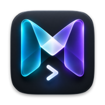
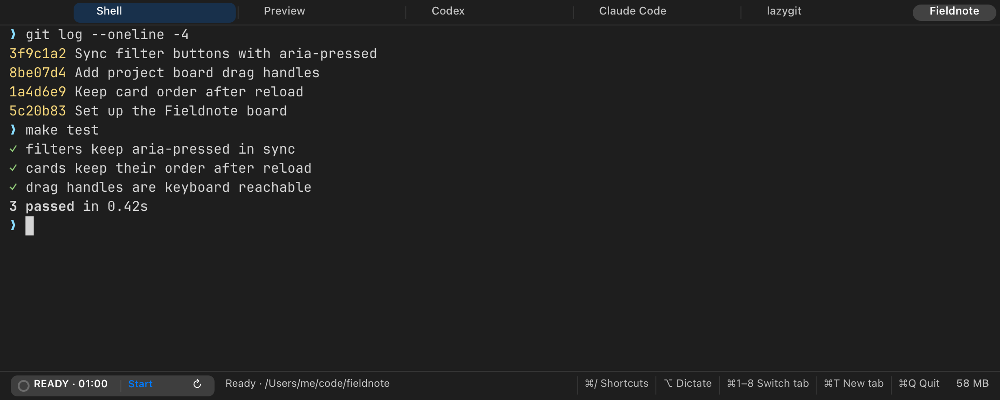

<p align="center">
  
</p>

<h1 align="center">Mica</h1>

<p align="center">
  <strong>Know exactly which project you’re in.</strong><br>
  Give every project a named window. See its name, then switch by name from one Dock icon. Terminal tabs and a focus timer are built in.
</p>

<p align="center">
  <a href="https://github.com/megasoft1978/mica-terminal/releases/tag/v0.1.0-alpha.17"></a>
  
  <a href="LICENSE"></a>
</p>

<p align="center"><strong>Free · Apple silicon · macOS 14 or later · 10.7 MB download</strong></p>

<p align="center">
  <a href="https://megasoft1978.github.io/mica-terminal/">Website</a> ·
  <a href="https://github.com/megasoft1978/mica-terminal/releases/download/v0.1.0-alpha.17/Mica.zip"><strong>Download</strong></a> ·
  <a href="https://github.com/megasoft1978/mica-terminal/releases/tag/v0.1.0-alpha.17">Release notes</a> ·
  <a href="LICENSE">MIT license</a>
</p>

<p align="center">
  <picture>
    <source media="(prefers-color-scheme: light)" srcset="docs/assets/mica-light.png">
    
  </picture>
</p>
<p align="center"><sub>A real Mica window with fictional project and terminal content.</sub></p>


## What Mica does

- **Keeps projects distinct.** Each project opens in its own window. The project name stays in the window title and top-right badge; hover over the badge to read the full name. Right-click Mica’s single Dock icon to switch between open project windows. The icon mark follows the front project, and each menu entry includes its active tab. Project windows share Mica’s main process.
- **Keeps terminal work together.** Use ordinary `zsh` tabs for Shell, Claude Code, Codex, `lazygit` or other programs. Mica’s activity detection is designed for Claude Code and Codex; screen-based detection is best-effort, and other programs are not guaranteed an agent status. Restored tabs normally start fresh. If enabled, Mica can resume Claude Code or Codex when a validated session ID is available; arbitrary processes and scrollback do not resume.
- **Organizes with tabs and project windows.** Mica does not have split panes yet.
- **Finds actions and text.** The Command Palette (<kbd>⌘⇧P</kbd>) searches menu actions and project tabs. Quick Select (<kbd>⌘⇧U</kbd>) labels visible URLs, existing file paths and Git hashes; type a label to copy, or hold <kbd>⌥</kbd> to open or reveal it. Prompt landmarks and last-command output are available with <kbd>⌘↑</kbd>/<kbd>⌘↓</kbd> and the Edit menu.
- **Adds a focus band.** Every window has a band under its tabs with the phase, countdown, editable project and branch label, timer controls and today’s focus total (the session count while a timer runs). Start with <kbd>⌥⌘P</kbd>; click it for per-project time. During focus, agent notifications are held except permission requests, then released and summarized when focus ends or is paused.
- **Swaps a tab to lazygit.** <kbd>⌥⌘G</kbd> or the branch glyph on a tab's sidebar row replaces the view with lazygit in the same folder and back; the lazygit session stays alive while hidden and is closed after 10 idle minutes.
- **Connects through OpenSSH.** Save a host or `~/.ssh/config` alias and an optional remote folder. Mica opens a fresh interactive SSH tab using macOS OpenSSH and your existing keys, agent and host-key checks. It stores no SSH passwords or private keys.

## Memory snapshot

These are measured idle footprints for one window on the same Apple silicon Mac. The Mica measurement was made on **September 29, 2026**, before alpha 16; it is a dated baseline, not a measurement of the current release.

| App | What was measured | Idle memory |
| --- | --- | ---: |
| **Mica** (3 tabs) | terminal and focus timer | **about 55–60 MB** |
| Alacritty | terminal | 69 MB |
| kitty | terminal | 80 MB |
| iTerm2 | terminal | 126 MB |

Extra project windows share the main Mica process. Window size, settings and macOS affect memory; [the measurement notes](docs/MEMORY-BASELINE.md) include the method and limits.

## Install

1. [Download Mica.zip](https://github.com/megasoft1978/mica-terminal/releases/download/v0.1.0-alpha.17/Mica.zip), extract it and move Mica to Applications. This build is signed and notarized; verify the ZIP with the [SHA-256 manifest](https://github.com/megasoft1978/mica-terminal/releases/download/v0.1.0-alpha.17/SHA256SUMS.txt).

## Project launchers

Choose **Mica → New Project Launcher…**, or run `make new-instance`. To create one from a script:

```sh
python3 scripts/install-desktop-apps.py --new-instance \
  --name "My Project" --folder ~/code/my-project --command codex
```

Edit a project's named tabs and folders in **Project → Project Settings…**. A `.mica` layout can include startup commands and saved SSH profiles. Run `python3 scripts/install-desktop-apps.py --help` for launcher options.

## SSH connections

Create profiles in **Session → SSH Connections…** with a friendly name, OpenSSH destination and optional remote folder. Put identity files, jump hosts, ports and VPN routes in `~/.ssh/config`; Mica preserves OpenSSH’s host-key checks. Restored SSH tabs create fresh connections. See the [SSH profile notes](docs/PLAN-SSH-PROFILES.md) for setup and limits.

## Shortcuts

| Action | Shortcut |
| --- | --- |
| Switch tabs | <kbd>⌘1</kbd>–<kbd>⌘9</kbd> |
| Search actions and tabs | <kbd>⌘⇧P</kbd> |
| Quick Select | <kbd>⌘⇧U</kbd> |
| Find in terminal | <kbd>⌘F</kbd> |
| Previous / next prompt | <kbd>⌘↑</kbd> / <kbd>⌘↓</kbd> |
| Change theme | <kbd>⌥⌘L</kbd> |
| Swap the tab to lazygit and back | <kbd>⌥⌘G</kbd> |
| Clear scrollback | <kbd>⌘K</kbd> |
| Show all shortcuts | <kbd>⌘/</kbd> |

## Build and develop

You need Xcode’s command-line tools. The terminal parser is vendored.

```sh
git clone https://github.com/megasoft1978/mica-terminal.git
cd mica-terminal
make app
```

Useful checks and media tools:

```sh
make test       # PTY, UI, launcher and fixture checks; never prompts agent CLIs
make sanitize   # session tests and fuzzer under AddressSanitizer and UBSan
make stress     # randomized UI actions under the sanitizers
make demo-assets # refresh native UI captures, project and feature videos, GIFs and posters
```

Mica uses AppKit and a C session core; vendored [libvterm](third_party/libvterm) parses escape sequences. See [performance notes](docs/PERFORMANCE.md), [release steps](docs/RELEASING.md), [contributing](CONTRIBUTING.md) and [security](SECURITY.md).

## License
Mica is MIT licensed and uses [JetBrains Mono](https://github.com/JetBrains/JetBrainsMono) (SIL OFL 1.1).
